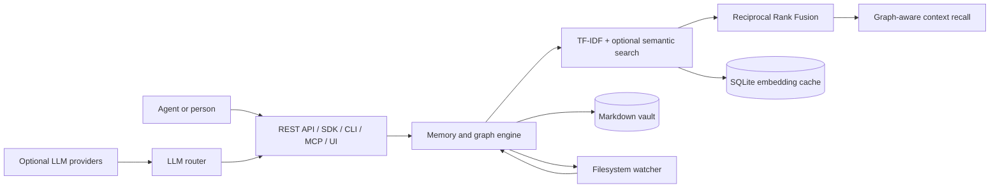
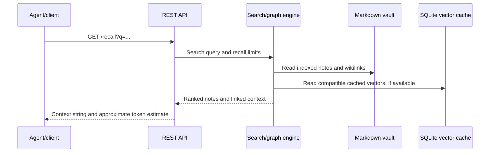

# Graph-RAG Agent Memory Service

A local-first learning project that demonstrates how an AI agent can store and retrieve useful context between tasks. Memories are Markdown files in an Obsidian-compatible vault, linked with `[[wikilinks]]`, and exposed through a Node.js REST API, JavaScript SDK, CLI, MCP server, and browser visualizer.

This project explores application-level AI concepts: retrieval, graph traversal, optional embeddings, and LLM provider routing. It does not train a model or claim measured gains in retrieval quality, latency, or token usage.


## Table of Contents

- [1. Executive Summary](#1-executive-summary)
  - [1.1 Core Problem Statement](#11-core-problem-statement)
  - [1.2 Technical Philosophy & Invariants](#12-technical-philosophy--invariants)
  - [1.3 High-Level Technology Matrix](#13-high-level-technology-matrix)
- [2. Architecture Overview](#2-architecture-overview)
  - [2.1 Layered Architecture Diagram](#21-layered-architecture-diagram)
  - [2.2 Separation of Concerns & Boundary Enforcement](#22-separation-of-concerns--boundary-enforcement)
- [3. Project Structure](#3-project-structure)
  - [3.1 Directory Tree](#31-directory-tree)
  - [3.2 Module Responsibility Matrix](#32-module-responsibility-matrix)
- [4. Core Features & Subsystems](#4-core-features--subsystems)
  - [4.1 Markdown Memory Store & Knowledge Graph](#41-markdown-memory-store--knowledge-graph)
  - [4.2 Hybrid Retrieval & Embedding Cache](#42-hybrid-retrieval--embedding-cache)
  - [4.3 Graph-Aware Context Recall](#43-graph-aware-context-recall)
  - [4.4 LLM Routing & Memory Consolidation](#44-llm-routing--memory-consolidation)
  - [4.5 API Access & Live Vault Updates](#45-api-access--live-vault-updates)
- [5. Service Layer Documentation](#5-service-layer-documentation)
- [6. API Documentation](#6-api-documentation)
  - [6.1 Core Endpoints & Route Definitions](#61-core-endpoints--route-definitions)
  - [6.2 Key Request & Response DTOs](#62-key-request--response-dtos)
- [7. Configuration Reference](#7-configuration-reference)
- [8. Deployment & Setup Guide](#8-deployment--setup-guide)
  - [8.1 Prerequisites](#81-prerequisites)
  - [8.2 Install & Choose a Vault](#82-install--choose-a-vault)
  - [8.3 Start the API & MCP Server](#83-start-the-api--mcp-server)
  - [8.4 Launch the UI & CLI](#84-launch-the-ui--cli)
  - [8.5 Run a Local Demo](#85-run-a-local-demo)
  - [8.6 CI & Developer Checks](#86-ci--developer-checks)
- [9. Workflow Diagrams](#9-workflow-diagrams)
- [10. Troubleshooting & Operations Guide](#10-troubleshooting--operations-guide)
- [11. Verification & Empirical Benchmarks](#11-verification--empirical-benchmarks)

## 1. Executive Summary

The service gives an agent or application a persistent notebook. A client saves a memory, searches for relevant notes later, and can request a context string containing the selected notes and their linked neighbors. Notes stay human-readable on disk and can be edited with a Markdown editor such as Obsidian.

### 1.1 Core Problem Statement

An LLM request does not automatically retain information from earlier tasks. This project provides a small external memory store and retrieval API so a client can save information and fetch related notes when building a later prompt. The client remains responsible for calling its LLM and deciding what to do with the returned context.

### 1.2 Technical Philosophy & Invariants

- **Readable source data:** Markdown files are the persistent memory records; graph relationships come from `[[wikilinks]]`.
- **Local-first core:** The API, vault, graph, and keyword search work without hosted model credentials.
- **Optional AI integrations:** Embeddings and LLM provider calls add features but are not required to start the service.
- **Model-aware vectors:** Cached embeddings record their source model and content hash; stale or incompatible vectors are excluded from semantic ranking.
- **Bounded recall:** Recall uses a configurable, approximate character-based token estimate, not a model-specific tokenizer.
- **Safe network default:** The API binds to loopback by default; binding to a non-loopback address requires `BRAIN_KEY`.

### 1.3 High-Level Technology Matrix

| Area | Technology | Role |
|---|---|---|
| Runtime | Node.js 22.5+ | Native HTTP server, filesystem, fetch, and SQLite APIs |
| Memory storage | Markdown + YAML frontmatter | Human-readable notes and metadata |
| Graph | Obsidian-style wikilinks | Relationships between memories |
| Keyword retrieval | TF-IDF | Local text-based ranking |
| Semantic retrieval | Optional OpenAI/Gemini embeddings; optional local Transformers model | Embedding similarity for notes and queries |
| Vector cache | SQLite via `node:sqlite` | Persist vectors with content hashes and model IDs |
| Hybrid ranking | Reciprocal Rank Fusion (RRF) | Combine keyword and semantic result rankings |
| LLM providers | Anthropic, Gemini, OpenAI-compatible, NVIDIA, Ollama | Optional routed generation for selected features |
| Interfaces | REST, JavaScript SDK, CLI, MCP, browser UI | Ways for clients and people to access the service |
| Tests / CI | `node:test`, GitHub Actions | Automated behavior tests and syntax checks |

## 2. Architecture Overview

### 2.1 Layered Architecture Diagram



### 2.2 Separation of Concerns & Boundary Enforcement

- `api/brain_engine.js` loads and indexes vault notes, parses links, searches, and builds graph/context results.
- `api/server.js` handles HTTP routes, authentication, request parsing, and API responses.
- `sdk/` contains the HTTP client, retrieval helpers, provider configuration, task/message helpers, and CLI launcher.
- `mcp/server.js` adapts the REST API for MCP clients.
- `ui/` contains the browser visualizer; it reads and updates data through the REST API.
- `test/` exercises the modules and API with temporary vaults and mocked provider responses.

## 3. Project Structure

### 3.1 Directory Tree

```text
.
├── .github/workflows/ci.yml
├── api/                 # HTTP server and vault/graph engine
├── assets/              # Visualizer previews
├── mcp/                 # MCP stdio server
├── migrations/          # Vault migration scripts and conventions
├── sdk/                 # Client SDK, CLI, embeddings, LLM router, utilities
├── test/                # Node test suite
├── ui/                  # Browser graph and org-chart views
├── vault/               # Example Markdown memories and linked notes
├── package.json
└── README.md
```

### 3.2 Module Responsibility Matrix

| Module | Responsibility |
|---|---|
| `api/server.js` | REST API, route handling, auth, request limits, SSE, and startup |
| `api/brain_engine.js` | Markdown parsing/writing, graph construction, keyword search, hybrid ranking, recall |
| `sdk/index.js` | JavaScript client for the REST API |
| `sdk/embeddings.js` | Provider calls, SQLite vector cache, content hashes, cache migration |
| `sdk/llm_router.js` | Optional provider selection, fallback, and JSON response parsing |
| `sdk/dedup.js` | Candidate similarity scan and optional LLM duplicate judge |
| `sdk/task_queue.js`, `sdk/messenger.js` | Vault-backed task and message helpers |
| `sdk/org_chart.js` | Org-chart data derived from agent notes |
| `sdk/cli.js`, `sdk/open_ui.js` | Command-line and browser launchers |
| `mcp/server.js` | MCP tools backed by the local REST API |
| `ui/index.html` | D3 graph viewer and org-chart view |

## 4. Core Features & Subsystems

### 4.1 Markdown Memory Store & Knowledge Graph

Notes are Markdown files with YAML frontmatter. The engine parses `[[wikilinks]]` to build graph edges, backlinks, and related-note traversal. Editing a note in a Markdown editor remains compatible with the vault format.

### 4.2 Hybrid Retrieval & Embedding Cache

Keyword search uses TF-IDF. When embeddings are configured and cached, the semantic result list is combined with keyword results using Reciprocal Rank Fusion. The embedding cache is stored in SQLite and tracks note content hashes and embedding model IDs so stale or cross-model vectors do not affect rankings. Retrieval quality has not been measured against a labeled benchmark set.

### 4.3 Graph-Aware Context Recall

`/recall` searches for seed notes, follows wikilinks up to the requested hop limit, and returns selected notes plus a prompt-ready context string. The supplied budget is enforced using a portable character-based estimate; actual token counts vary by model tokenizer.

### 4.4 LLM Routing & Memory Consolidation

The shared LLM router supports configured provider fallbacks. It is used by optional LLM-backed operations such as memory consolidation and duplicate judging. Consolidation validates the returned title, content, and tags before writing a new note and archiving source memories. Provider calls require the user's own configuration; automated tests mock provider responses.

### 4.5 API Access & Live Vault Updates

The API binds to `127.0.0.1` by default. A filesystem watcher reloads the index after Markdown changes. When `BRAIN_KEY` is configured, protected API routes require a bearer token; non-loopback binding is rejected without a key. The server accepts JSON request bodies up to 1 MiB.

## 5. Service Layer Documentation

| Service | Inputs | Output / side effect |
|---|---|---|
| Memory and graph engine | Vault files, memory text, search query | Parsed notes, graph links, ranked results, recalled context |
| Embedding service | Note/query text and optional provider credentials | Model-tagged vector in SQLite; failures leave keyword search available |
| LLM router | System/user prompts and provider configuration | Text or validated JSON from the first successful configured provider |
| Deduplication service | Nodes, optional embeddings, optional LLM judge | Possible duplicate pairs for review; scan does not auto-merge |
| Task queue / messenger | Task or message fields | Markdown-backed task and message records |
| MCP adapter | MCP JSON-RPC tool requests | Calls to the local REST API |

## 6. API Documentation

All routes use `http://127.0.0.1:3747` by default. JSON write requests use `Content-Type: application/json`. When `BRAIN_KEY` is set, send `Authorization: Bearer <key>` to protected routes.

### 6.1 Core Endpoints & Route Definitions

| Method | Route | Purpose |
|---|---|---|
| `GET` | `/health` | Service status and vault counts |
| `GET` | `/nodes`, `/node/:id` | List or retrieve memory nodes |
| `GET` | `/search?q=...&limit=10` | Keyword and optional semantic search |
| `GET` | `/recall?q=...&hops=1&maxTokens=2000` | Retrieve graph-connected context |
| `GET` | `/graph`, `/type/:type`, `/tags`, `/tag/:tag`, `/agent/:name` | Browse graph and filtered notes |
| `POST` | `/remember` | Save a memory note |
| `PATCH`, `DELETE` | `/node/:id` | Update or delete a note |
| `POST` | `/consolidate` | Consolidate memory notes with a configured LLM |
| `POST` | `/dedup/scan` | Report possible duplicates for review |
| `POST` | `/embeddings/reindex` | Start background embedding refresh |
| `POST` | `/tasks/submit`, `GET /tasks`, `PATCH /tasks/:id` | Manage vault-backed tasks |
| `POST` | `/messages/send`, `GET /messages/:agent` | Send and read agent messages |
| `GET` | `/org-chart`, `/export` | Read org chart or export vault data |
| `POST` | `/reload` | Reload the vault index |
| `GET` | `/stream` | Subscribe to server-sent events |

### 6.2 Key Request & Response DTOs

Save a memory:

```json
{
  "title": "Token Bucket Design",
  "content": "A token bucket handles burst traffic.",
  "type": "memory",
  "agent": "demo-agent",
  "tags": ["rate-limits"]
}
```

Recall context:

```http
GET /recall?q=rate%20limiting&hops=1&maxTokens=1500
```

The response includes `query`, `nodes`, `nodeCount`, `tokenEstimate`, and `systemPrompt`. `tokenEstimate` is approximate and can differ from a provider's tokenizer.

## 7. Configuration Reference

| Variable | Purpose | Default |
|---|---|---|
| `BRAIN_HOST` | API bind interface | `127.0.0.1` |
| `BRAIN_PORT` | API port | `3747` |
| `BRAIN_KEY` | Protect API routes; required for non-loopback bind | unset |
| `BRAIN_VAULT` | Path to Markdown vault | repository `vault/` |
| `AUTO_GIT_SYNC` | Enable path-scoped Git sync for vault edits | `false` |
| `LLM_PROVIDER_ORDER` | LLM fallback order | `anthropic,nvidia,gemini,openai,ollama` |
| `ANTHROPIC_API_KEY`, `GEMINI_API_KEY`, `NVIDIA_API_KEY` | Optional hosted LLM credentials | unset |
| `OPENAI_API_KEY`, `OPENROUTER_API_KEY` | Optional OpenAI/OpenRouter chat credentials; OpenAI key can also enable embeddings | unset |
| `OLLAMA_HOST`, `OLLAMA_MODEL` | Local Ollama endpoint and model | `http://localhost:11434`, `llama3.2:3b` |
| `OPENAI_EMBEDDING_MODEL`, `GEMINI_EMBEDDING_MODEL` | Embedding model IDs | configured defaults in `sdk/models_config.js` |
| `OPENAI_EMBEDDING_API_BASE` | OpenAI-compatible embedding endpoint | `https://api.openai.com/v1` |

Provider model IDs and API bases can be overridden with the variables documented in `sdk/models_config.js`. Keep credentials in local environment variables; do not commit them.

## 8. Deployment & Setup Guide

### 8.1 Prerequisites

- Node.js 22.5 or newer (`node:sqlite` is used for the embedding cache).
- A browser for the visualizer.
- Optional: a hosted provider API key or a local Ollama installation for LLM/embedding features.

### 8.2 Install & Choose a Vault

```bash
git clone https://github.com/Juixe7/Graph-RAG-Agent-Memory-Service.git
cd Graph-RAG-Agent-Memory-Service
```

The project has no required npm dependencies, so `npm install` is not needed. It includes sample Markdown notes under `vault/`. To use another vault, set `BRAIN_VAULT` to its path before starting the server.

### 8.3 Start the API & MCP Server

Start the REST API:

```bash
npm start
```

Configure an MCP-aware client to launch the stdio server with `node mcp/server.js` from the repository root. The MCP server starts the REST API automatically when its first tool request arrives if the API is not already running. `npm run mcp` launches the process for an MCP client that manages its standard input and output.

```bash
npm run mcp
```


### 8.4 Launch the UI & CLI

```bash
npm run ui
npm run brain -- status
npm run brain -- search "rate limiting"
npm run brain -- recall "rate limiting" --hops=1 --tokens=1500
```

The visualizer connects to the local API and displays the notes and links in the vault. It is an interface for inspecting the memory graph; it does not itself demonstrate semantic retrieval quality.

### 8.5 Run a Local Demo

1. Start the API with `npm start`.
2. Open the UI with `npm run ui`; inspect nodes and their wikilink connections.
3. Search or recall a topic in the CLI, for example `npm run brain -- recall "artificial intelligence" --hops=1`.
4. Save a test memory through the UI or SDK, then reload and inspect its graph connections.

Optional provider features can be demonstrated by setting a provider key in the local environment. Do not put keys in source files or screenshots.

### 8.6 CI & Developer Checks

GitHub Actions runs `npm test` and `node --check` over JavaScript modules on Node.js 22.x and 24.x for pushes and pull requests targeting `main`. Run the same project checks locally with:

```bash
npm test
```

## 9. Workflow Diagrams

Memory retrieval flow:



## 10. Troubleshooting & Operations Guide

| Symptom | Check |
|---|---|
| API does not start | Confirm Node.js is 22.5+ and port `3747` is available. |
| UI says Offline | Start the API first; check the API URL in the UI. |
| API returns `401` | Enter the configured `BRAIN_KEY` in the UI or send the bearer token. |
| Remote bind is rejected | Set `BRAIN_KEY`, or use the loopback default. |
| Semantic search returns no additional results | Configure an embedding provider, run `POST /embeddings/reindex`, and check server logs. Keyword search remains available without embeddings. |
| LLM feature fails | Check the selected provider key, model configuration, provider availability, and `LLM_PROVIDER_ORDER`. |
| A note edit is not reflected | Wait for the filesystem watcher or call `POST /reload`. |

## 11. Verification & Empirical Benchmarks

The test suite covers selected storage, graph, retrieval, provider-routing, and API behavior. Provider network responses are mocked in tests; passing tests do not verify a live provider account.

Local verification on Node.js 23.6.0: **81 tests passed**. The GitHub Actions workflow separately checks Node 22.x and 24.x after a push.

No labeled retrieval dataset or performance benchmark is currently included. Do not interpret the approximate recall token estimate as measured token savings or a quality metric.
